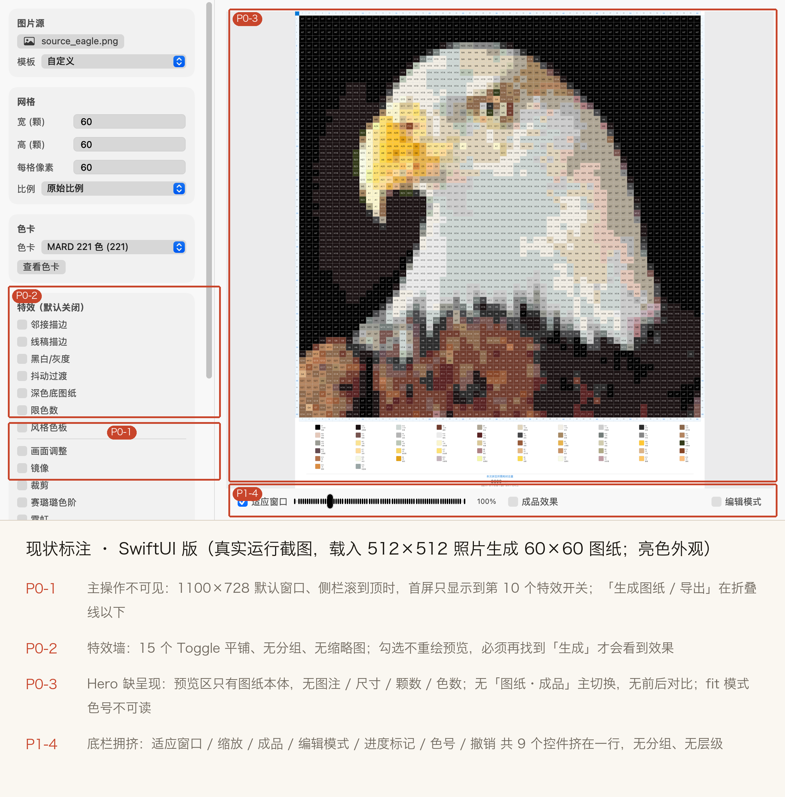
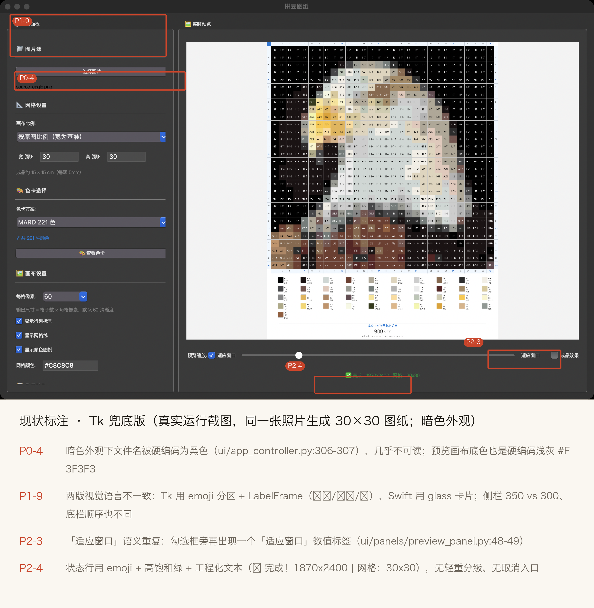
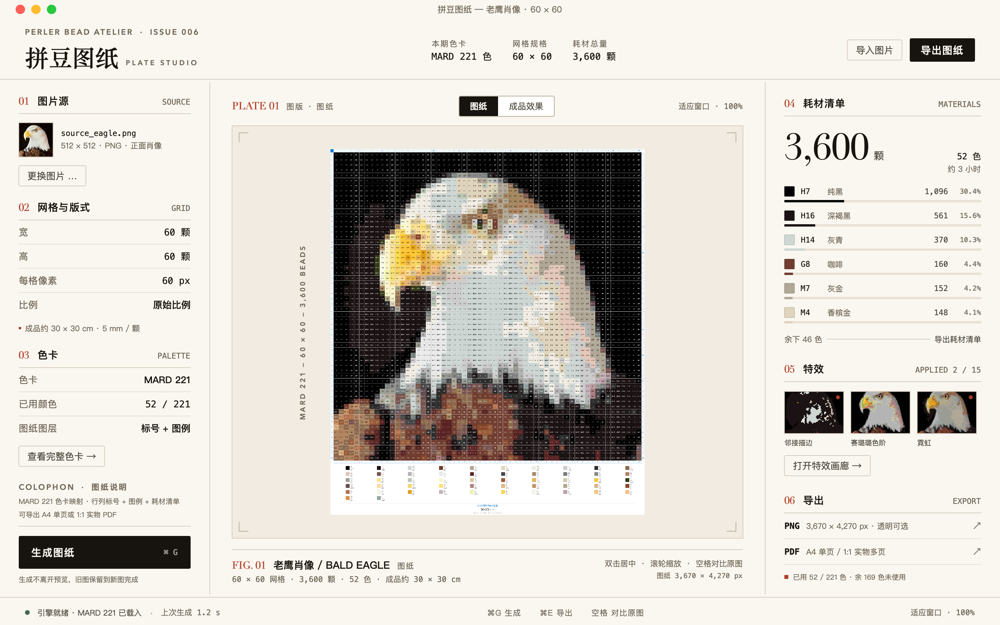
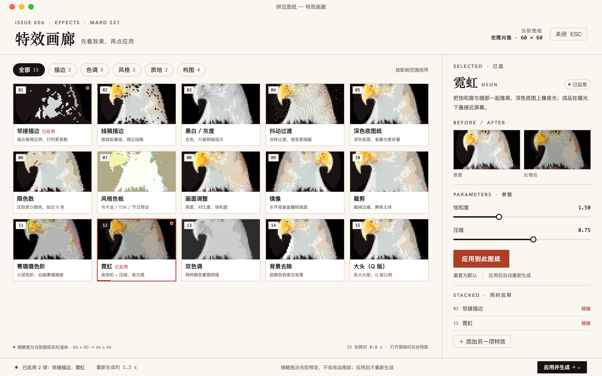
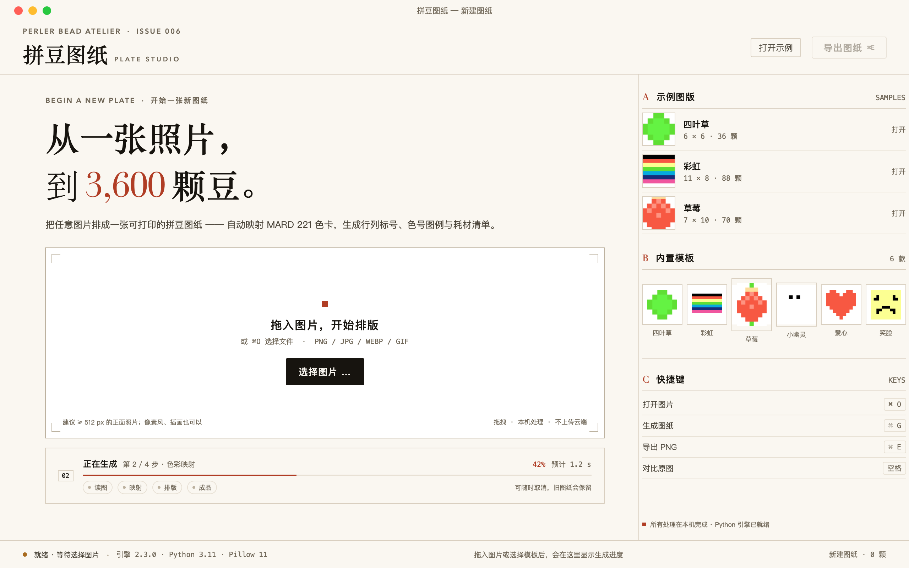

# 拼豆图纸 · UI 现状审计与「编辑杂志风」重构方向

> **任务**：Shared Task task-2（owner: ui-audit）  
> **交付**：现状取证截图（真实运行）→ P0/P1/P2 UX 缺陷 → editorial design tokens → 逐屏规格 → 3 张可看重构 mockup → 文件级实施计划 → 设计师明确观点  
> **写作用域**：仅 `qa/ui/`（未改 `app/`、`ui/`、`core/`、`output/` 与任何产品源码/测试）  
> **日期**：2026-10-21 · 环境：macOS 27.0.1 / Swift 6.4 / Python 3.11（conda pindou）/ App 2.3.0

---

## 0. 结论摘要（TL;DR）

1. **现状不是「不好看」这么简单，而是信息架构坏了**：真实默认窗口 1100×728（暗色外观）下，侧栏滚到顶只能看到第 10 个特效开关，「生成图纸 / 导出」在折叠线以下。用户验证一个特效要：勾 Toggle → 滚动找生成 → 点击 → 等预览 → 判断，**每试一个特效都要重复一次**。这是「特效代码可行但效果不可行」在 UI 层的直接原因之一。
2. **图纸本身很有「杂志图版」潜质**：60×60 MARD 221 图纸放大后是一张漂亮的点阵印刷品。现状把它塞进灰色矩形里：fit 模式色号不可读、四周没有图注/尺寸/颗数/色数，等于把最有说服力的资产藏起来。
3. **建议做「克制的高级杂志感」（6/10），不做「全套编辑部」**：编辑部手法只用在 **报头 / 图注 / 空状态 / 特效画廊 / 色卡页 / 导出封面** 这 6 个展示面；**工作台**保持 4pt 密度参数表、常驻主操作、全键盘可达。杂志感来自版式纪律（网格、字阶、发丝线、单一强调色、图注编号），不是装饰。
4. **一句话方案**：左栏 = 规格表 spec sheet（268pt）；中间 = 图版 plate（图纸 hero + 图注 + 图纸/成品切换）；右栏 = 耗材与导出 inspector（300pt）；顶部报头；底部 38pt 状态条。15 个 Toggle 变成 **特效画廊 contact sheet**：每张卡是当前图纸的实时效果缩略图，点卡只预览，确认才应用并重新生成，配 before/after 参数面板。
5. **收益/成本**：perceived quality 与特效可发现性提升明显；主要风险是中文衬线字体跨平台、留白侵蚀效率、ContentView 重写的回归面。建议先做 Phase 0「效率止血」（0.5 天，不动视觉），再进 Phase 1 视觉重排。

---

## 1. 取证方法与证据

### 1.1 真机启动（SwiftUI 主推版）

`~bash
cd app && swift build                      # 构建产物已存在：app/.build/debug/PerlerApp
./.build/debug/PerlerApp &                 # 真实启动
# 通过 CGWindowList 取窗口号，再按窗口截图（无需整屏，避免其它 App 干扰）
screencapture -x -o -l <CGWindowID> qa/ui/shots/real_02_window.png
`~

- 实测窗口：**1100 × 728**（CGWindowList：X=185, Y=95, W=1100, H=728；即内容区 1100×700 + 标题栏），与 `PerlerApp.swift` 的 `frame(minWidth: 1100, minHeight: 700)` 一致。
- 本机系统为暗色外观，真实截图即暗色版；亮色版通过同一份源码的离屏 harness 强制 `.aqua` 外观取证。
- 截图能力：`screencapture` 可用；**辅助功能/自动化不可用**（`AXIsProcessTrusted=false`，System Events 返回 `-10004 privilege violation`），因此无法用键盘/AppleScript 驱动真 app 选图。此限制如实记录。

### 1.2 内容态取证（同一份源码的离屏 harness）

真 app 无法自动化选图，所以内容态（已生成图纸、亮色、展开参数、色卡弹窗）用 `qa/ui/render/` harness 取证：

- harness 复制 `app/Sources/PerlerApp/{ContentView,ColorChartView,AppViewModel,Engine,Models}.swift`，**只改两处**：
  1. `@StateObject private var vm = AppViewModel()` → `@ObservedObject var vm: AppViewModel`（允许 harness 注入并驱动 VM）；
  2. `Engine.engineScript` 的仓库根定位改为 `PERLER_REPO_ROOT`（复制后 `#filePath` 层级变化）。
- 视图、VM、引擎协议、`core_server.py` 全部是真实代码；生成结果真实落盘后复制到 `qa/ui/assets/` 做 mockup 素材。
- 生成参数：照片 `qa/lead/inputs/eagle.png` 512×512 → 网格 60×60 / 每格 60px / MARD 221 → **3,600 颗、52 色**（真实引擎结果）。

**证据分级**：`real_*.png` = 真实二进制运行截屏；`harness_*.png` = 同源码离屏宿主截屏（仅上述一行注入差异）；`mockups/` = 新设计稿，不是现状。

### 1.3 证据清单

| 文件 | 内容 | 来源 |
|---|---|---|
| `shots/real_01_fullscreen.png` | 真 app 首次启动（整屏） | 真实运行 |
| `shots/real_02_window.png` | 真 app 窗口（暗色、空状态） | 真实运行 |
| `shots/real_03_tk_window.png` | Tk 版首屏（暗色） | 真实运行 |
| `shots/real_04_tk_content.png` | Tk 版载入照片生成 30×30 图纸 | 真实运行（harness 驱动 `_load_image_file`，输出目录重定向 `qa/ui/tmp/tk_output`） |
| `shots/harness_current_1100_light.png` | SwiftUI 内容态 1100×728 亮色 | 同源码离屏 |
| `shots/harness_current_1280_light.png` | SwiftUI 内容态 1280×800 亮色 | 同源码离屏 |
| `shots/harness_current_1100_dark.png` | SwiftUI 内容态暗色 | 同源码离屏 |
| `shots/harness_effects_expanded_light.png` | 展开邻接描边/霓虹 + 编辑模式 | 同源码离屏 |
| `shots/harness_colorschart_light.png` | 色卡弹窗 | 同源码离屏 |
| `shots/annotated_swift_current.png` | **现状标注图（SwiftUI）** | 人工标注 |
| `shots/annotated_tk_current.png` | **现状标注图（Tk）** | 人工标注 |
| `assets/eagle_chart.png` / `eagle_finished.png` / `eagle_result.json` | 真实生成物与统计数据 | 引擎输出复制 |
| `assets/effects/*.png` | 15 项特效真实产物（29×29） | `qa/lead/artifacts` 复制，作画廊缩略图 |

### 1.4 复跑

`~bash
# 1) 重新复制源码 + 打补丁
qa/ui/render/prepare_sources.sh
# 2) 构建离屏 harness（--disable-sandbox：本机沙箱不允许 SwiftPM 嵌套 sandbox-exec）
cd qa/ui/render && swift build --disable-sandbox \
  --cache-path ../../qa/ui/tmp/spm-cache --config-path ../../qa/ui/tmp/spm-config \
  --security-path ../../qa/ui/tmp/spm-security
# 3) 现状截图（真实引擎生成 + 窗口快照）
cd /path/to/PerlerBeadApp && PERLER_REPO_ROOT=$PWD TMPDIR=$PWD/qa/ui/tmp \
  qa/ui/render/.build/debug/UIShot audit
# 4) 重构 mockup（ImageRenderer 2x → PNG）
PERLER_REPO_ROOT=$PWD TMPDIR=$PWD/qa/ui/tmp qa/ui/render/.build/debug/UIShot mockups
`~

---

## 2. 现状审计

### 2.1 现状截图

**SwiftUI 版（内容态 + 标注）**：P0-1 主操作不可见 / P0-2 特效墙 / P0-3 hero 无呈现 / P1-4 底栏拥挤。

**Tk 兜底版（内容态 + 标注）**：P0-4 暗色硬编码 / P1-9 双端视觉语言不一致 / P2-3 语义重复 / P2-4 状态行。

**更多证据**：真 app 空状态 `shots/real_02_window.png`；亮色 `shots/harness_current_1100_light.png`；暗色 `shots/harness_current_1100_dark.png`；展开参数 `shots/harness_effects_expanded_light.png`；色卡弹窗 `shots/harness_colorschart_light.png`。

### 2.2 信息架构：默认窗口下「要用什么，就得先滚」

ContentView 结构（`app/Sources/PerlerApp/ContentView.swift`，435 行）：

`~
HStack(spacing: 0)
├─ settingsPanel.frame(width: 300)          ← ScrollView，单列堆叠
│   ├─ glassSection("图片源")                  按钮 + 模板 Picker
│   ├─ glassSection("网格")                    4 行输入 + 比例 Picker
│   ├─ glassSection("色卡")                    色卡 Picker + 查看色卡
│   ├─ glassSection("特效（默认关闭）")        15 个 Toggle + 参数（不分组）
│   ├─ glassSection("操作")                   生成 / 取消 / 导出 / PDF 模式对话框
│   └─ HStack(进度条 + statusText)             ← 状态在侧栏最底部
└─ previewPanel                              预览 + 底部一行控件
`~

默认 1100×728、侧栏滚到顶时：**首屏可见 = 图片源 / 网格 / 色卡 / 特效前 7–10 项**；「生成、取消、导出 PNG/PDF、进度、状态文本」全部在折叠线以下。最高频动作（生成、导出）首屏不可见；最低频的 15 个特效开关占据侧栏一半高度。**首屏优先级倒置，这是第一 P0。**

### 2.3 P0 缺陷（阻断核心任务）

| 编号 | 问题 | 证据 | 影响 | 方向 |
|---|---|---|---|---|
| **P0-1** | **主操作不可见**：默认 1100×728、侧栏滚到顶时首屏只到第 10 个特效开关；「生成 / 导出」在折叠线以下，无常驻操作条 | `annotated_swift_current.png`、`real_02_window.png` | 每次“调参→看效果”都要滚动，打断心流；新用户可能以为没有生成按钮 | 底部常驻 42pt 主操作条「生成图纸 ⌘G」（含导出分栏），永不随滚动消失 |
| **P0-2** | **特效墙**：15 个 Toggle 平铺、只有一个 Divider 分组、无缩略图/说明；**勾选 Toggle 不会重渲染预览**，必须再找到折叠线下的「生成」 | `harness_effects_expanded_light.png`（勾选“邻接描边”后预览完全没变）、`ContentView.swift:78–145`、`AppViewModel.generate()` 只由按钮触发 | 特效不可发现、不可试错，“看不见效果”= 不可行；与用户主诉强相关 | 特效画廊（缩略图卡）+ 选中即预览 + 「应用并生成」；参数面板带 before/after |
| **P0-3** | **Hero 无呈现**：预览区只有图纸本体 + 一行灰字；无图注/尺寸/颗数/色数；无「图纸/成品」主切换（成品只是底部小 Toggle）；无前后对比；fit 模式色号不可读（60×60 每格约 10px、色号 4px 高） | `harness_current_1100_light.png`、`harness_current_1100_dark.png` | 图纸这个最强资产没有被“展示”，用户/旁观看不出完成度；也无法快速判断效果 | Hero 图版：白衬纸 + 裁切角线 + 图注（FIG./网格/颗数/色数/成品 cm）+ 图纸/成品 segmented + 空格对比 |
| **P0-4** | **Tk 暗色外观不可读**：`_load_image_file` 把文件名 label 前景硬编码 `foreground="black"`，暗色下黑字黑底；预览画布底色硬编码 `#F3F3F3`，与系统暗色割裂 | `annotated_tk_current.png`（source_eagle.png 几乎不可见）、`ui/app_controller.py:306–307`、`ui/panels/preview_panel.py:26` | Tk 是兜底版，暗色 macOS 用户首屏即坏；“文件已选中”关键状态不可读 | 用主题变量替代硬编码；画布颜色进 theme（#FFFFFF light / #1C1915 dark） |

> 关于“特效效果不可行”：**视觉效果本身**的根因由 effects-qa 并行定位（本任务不越界）；但 **UI 层确实放大了它**——无缩略图、无实时反馈、无 before/after、参数不可见、入口在折叠线下。即使算法修好，现 UI 也不能让用户“看见效果”。这三点必须在重构里一起解决。

### 2.4 P1 缺陷（显著影响可用性 / 一致性）

| 编号 | 问题 | 证据 | 方向 |
|---|---|---|---|
| P1-1 | **特效无分组、命名工程化**：15 个 Toggle 只有一条 Divider；「特效（默认关闭）」「大头（Q版·需 OpenCV）」把工程语义直接暴露给用户 | `ContentView.swift:78–145` + 截图 | 按影响面分组：描边 2 / 色调 5 / 风格 2 / 质地 2 / 构图 4；名称 + 一句人话描述；OpenCV 依赖降级为「不可用」状态 + 说明 |
| P1-2 | **参数控件不统一**：滑杆行固定 48/38pt 宽、hex 用裸 TextField、Stepper、Picker/segmented 混用；行高/字重/数值格式（%.2f）不一致 | `ContentView.swift:198–218`、`harness_effects_expanded_light.png` | 统一控件族：EditorialSlider（3px 轨 + 11px 环）、Stepper 紧凑、hex 输入带色块、数值等宽 tabular |
| P1-3 | **状态设计缺失**：空状态只有一行灰字；加载态只有侧栏小 spinner（且在折叠线下）；错误态只有 statusText 的 caption；禁用态只靠系统自动变灰 | `ContentView.swift:169–181`、`real_02_window.png` | 空/加载/错误/禁用四态组件化；主视觉区承担状态反馈 |
| P1-4 | **底栏拥挤**：一行塞入 适应窗口 / 缩放滑杆 / 100% / 成品效果 / 编辑模式 / 进度标记 / 色号输入 / 撤销 共 7–9 个控件，4 类语义混在一起 | `harness_effects_expanded_light.png` 底栏 | 拆 3 组：视图（图纸/成品 + 适应窗口 + 缩放）· 对比（按住空格）· 编辑（编辑模式/进度/撤销） |
| P1-5 | **SwiftUI 版没有应用级菜单与快捷键**：唯一 keyboardShortcut 是色卡弹窗 ESC；⌘O/⌘G/⌘E 全无（Tk 反而有菜单与快捷键） | `grep keyboardShortcut app/Sources/PerlerApp/` 仅 1 处；`PerlerApp.swift` 无 Commands | 用 CommandGroup 补：文件（导入/导出 PNG/PDF）、图纸（生成/取消/适应窗口/对比）、视图（特效画廊/色卡）、帮助 |
| P1-6 | **色卡弹窗粗糙**：标题 🎨、组标题「【A组】26 色」、色号重复两次（色块内 + 下方）、固定 7 列、固定 1000×720、搜索无清除/无筛选 | `harness_colorschart_light.png`、`ColorChartView.swift:41–99` | 编辑式色样册：9 列响应式、编号 + 名称 + 用量、搜索/分组 chips、sticky header |
| P1-7 | **无 before/after、无 A/B**：只有「成品效果」一个 Toggle；无法对比原图/图纸/成品，也无法对比“加特效前/后” | `ContentView.swift:242–263` | 空格按住看原图 + 特效用左右或上下 A/B |
| P1-8 | **双端视觉语言不一致**：Tk 用 emoji 分区标题 + LabelFrame、侧栏 350；Swift 用 .regularMaterial 卡片 12 圆角、侧栏 300；底栏顺序不同；状态行位置/颜色不同 | `real_03/04` vs `harness_*`；`ui/app_controller.py:96–145`、`theme.py` | 抽共享 tokens（本文件 3.4）；Tk 只落地“子集”：颜色/字阶/间距/文案 |
| P1-9 | **Tk 与 Swift 功能不对等**：15 项特效只在 Swift 版；Tk 无特效入口（grep ui/ 无 effect） | `grep -rn "特效\|effect" ui/` 无结果；README 也写明“Swift 版特效库 15 项全暴露” | 决策：特效为 Swift 主打；Tk 至少提供「效果预设」下拉（3–5 个常用），README 标注差异 |

### 2.5 P2 缺陷（打磨项）

| 编号 | 问题 | 证据/位置 |
|---|---|---|
| P2-1 | 圆角 12 与 macOS 14+ 的 10pt 系统观感不一致；material 卡片在亮色下边界几乎不可见（仅 1.5% 亮度差） | `ContentView.swift:193–194` |
| P2-2 | 图标体系混用：Swift 有 SF Symbols 但极少；Tk 大量 emoji（⚙️🖼️📐🎨💾✅）；同一动作两版图标不同 | 截图 + `ui/panels/*` |
| P2-3 | Tk「适应窗口」语义重复：勾选框文字 + 数值 label 同时显示「适应窗口」 | `ui/panels/preview_panel.py:39–49`；`annotated_tk_current.png` |
| P2-4 | 状态文本工程化且高饱和：`✅ 完成！1870x2400 | 网格：30x30`，emoji + 绿色一起用，无轻重分级 | `ui/app_controller.py:354–357` |
| P2-5 | 数值未统一 tabular；caption 10pt 偏小；中文行高偏紧（默认约 1.2） | 截图；ContentView 全篇 |
| P2-6 | SwiftUI 窗口无状态记忆（尺寸/位置/最近图纸），Tk 反而有 window_w/h 持久化 | `core/settings.py` vs Swift 无 |
| P2-7 | 色卡下拉只显示数量，无法预览；模板 Picker 无缩略图 | `ContentView.swift:37–47, 69–73` |
| P2-8 | 空预览提示文字对比不足、位置在正中偏上，与暗色材质糊在一起 | `real_02_window.png` |
| P2-9 | 滚动条常驻、无 section 锚点；长侧栏无折叠 | `real_02_window.png` |
| P2-10 | 无 About/版本信息入口（Swift 版） | `PerlerApp.swift` |

### 2.6 视觉系统的量化现状

| 维度 | 现状 | 问题 |
|---|---|---|
| 字阶 | .headline 13 semibold / .callout 12 / .caption 10 / body 13；Tk 10/11/12/16 | 只有 3–4 级且间距近，无 display/deck/caption 编辑式跳跃；中文与数字同权 |
| 行高 | 系统默认 | 长说明文本行高偏紧；无 1.6–1.7 阅读行高 |
| 间距 | 侧栏 padding 12、section 间距 14、卡片内 8；Tk padding 15 | 非 4pt 栅格；卡片内/间节奏接近，层级靠 material 不靠留白 |
| 色彩 | 系统外观 + 唯一彩色 = 系统 accent blue（复选框/进度/滑杆） | 无品牌识别；强调色出现在最低价值控件上，而非主操作/当前状态 |
| 材质 | .ultraThinMaterial 全窗 + .regularMaterial 卡片 | 明暗外观下对比不可预期；灰糊；无“纸/墨”基调 |
| 圆角/阴影 | 卡片 12；无自定义阴影 | 与 macOS 系统 10 不一致；平面层级只有 material 一档 |
| 控件密度 | 滑杆 3 控件/行，Toggle 1/行，15 个 Toggle 约 400pt 高 | 密度不低但“密度没有结构”——低价值项占高价值空间 |
| 状态 | 空：一行灰字；加载：侧栏小 spinner；错误：caption；禁用：系统灰 | 无四态组件化；关键状态在视觉盲区 |
| 动效 | 无自定义 | 无反馈（勾选/生成/切换均瞬时） |
| 图标 | SF Symbols 少、emoji 多（Tk） | 风格不统一；emoji 跨系统渲染差异大 |

### 2.7 双 UI 一致性矩阵

| 维度 | SwiftUI（主推） | Tk（兜底） | 建议 |
|---|---|---|---|
| 侧栏宽 | 300pt | 350px | 统一 268–300；Tk 同步 tokens |
| 分区样式 | .regularMaterial 卡片 + 12 圆角 | LabelFrame + emoji 标题 + 15 padding | 统一「编号 + 中文标题 + 发丝线」，去 emoji 依赖 |
| 主操作位置 | 侧栏最底部（折叠线下） | 菜单/工具栏（无显式生成按钮） | 两版都改常驻底栏主操作 |
| 预览底栏 | 适应窗口 / 滑杆 / 100% / 成品 / 编辑 / 追踪 / 色号 / 撤销 | 预览缩放 / 适应窗口 / 滑杆 / 数值 / 成品 | 统一次序：视图 → 对比 → 编辑；数值只在非 fit 显示 |
| 状态显示 | 侧栏底部 caption + accent 色 | 预览下方居中 + emoji + 绿色 | 改底部状态条（左状态/中快捷键/右缩放） |
| 特效 | 15 项全暴露 | 无 | Swift 主打；Tk 至少 3–5 预设，README 注明差异 |
| 暗色 | 跟随系统 | 部分硬编码（black/#F3F3F3） | Tk 全量 token 化 |
| 色卡 | 1000×720 sheet，7 列 | 1400×900 Toplevel，6–9 列响应 | 统一 1120×760，9 列响应 |
| 快捷键 | 仅 ESC | ⌘O/⌘S/⌘P/⌘E/+/− | Swift 补齐；两版一致 |

### 2.8 「特效效果不可行」的 UI 责任链（与 effects-qa 分工）

**现象链**：打开 app → 默认暗色、15 开关无说明 → 勾选一个 → 预览没变化（P0-2）→ 滚动找生成（P0-1）→ 生成 0.4–1.2s → 预览只在“图纸”上，看不出前后差异（P1-7）→ 参数无法对比（P1-2）→ 结论“开了没用”。  
**UI 可修复**：可发现性、即时预览、before/after、参数可见、缩略图、常驻主操作。**UI 修不了**：特效像素质量（归 effects-qa）。两者必须同时修。

---

## 3. 「编辑杂志风」设计语言（落到桌面生产力工具）

### 3.1 概念隐喻：把拼豆图纸当成一本「图版集 / plate book」

- **图纸 = 图版（Plate）**：每张图纸有期号 / 图版号 / 图注（FIG. 01）/ 规格行；既是视觉资产也是产品事实（60×60、3600 颗、52 色、30×30cm）。
- **工作台 = 排版台**：左栏规格表（spec sheet）、中栏图版、右栏耗材/导出 inspector；职责固定，用户永远知道去哪。
- **特效 = 印前工艺**：描边/霓虹/双色调…是对图版的工艺处理；用 contact sheet（印样台）呈现比 Toggle 墙自然。
- **色卡 = 色样册（swatch book）**：天然适合编辑式网格 + 编号 + 名称 + 用量。
- **空状态 = 封面（cover）**：大字标题 + 留白 + 投放区（裁切角线）；唯一适合“封面式”表达的屏幕。

### 3.2 参考与出处（不凭空造“高级感”）

| 参考 | 出处（均已打开核实，检索日 2026-10-21） | 采纳点 |
|---|---|---|
| **open-design · editorial typography hierarchy** | https://github.com/nexu-io/open-design/blob/main/craft/typography-hierarchy-editorial.md | 编辑式字阶量化规则：display 56–96px vs body 16–18px（**3–5 倍跳跃**）；正文行高 1.6–1.7、measure 60–70ch；大字号追踪 -0.02~-0.05em（中文不适用负追踪）；留白承载层级、克制粗体；非对称节奏。本文件字阶/间距据此缩放到 1280×800。 |
| **Monocle 风格档（geoffreymanda/design-atlas）** | https://geoffreymanda.github.io/design-atlas/styles/monocle.html | 可引用数值：字号序列 13/16/18/20/24/28/32/34/40；行高 1.0–1.5；字距 display -0.02em、body +0.01em、small caps +0.05em、eyebrow +0.075em；3 栏栅格、1px 细线、无阴影、极小圆角、唯一信号色。注意 Plantin 为商业字体，替代用 Source Serif/Spectral/Playfair（OFL）。 |
| **Kinfolk（官网 + Refero 风格档）** | https://www.kinfolk.com · https://styles.refero.design/style/ac9b040e-36aa-4881-ada5-72d4744947a4 | Issue 编号/1/10 轮播编号/栏目系统；Ink Black + Bone White 的极简色板；自有字体不可用，中文用宋体/思源宋体替代。 |
| **Still Magazine Issue 00（Florian Cornut）** | https://abduzeedo.com/node/90164 | 超大留白、超大衬线报头、编号/图注系统、单一 spot color、图版优先。 |
| **Prefix Photo（Underline Studio）** | https://abduzeedo.com/node/90130 | 摄影书式版面：图版近满幅、图注紧贴图版、发丝线框。对应 hero 图版 + 图注簇。 |
| **工业产品目录/说明书**（Teenage Engineering OP-1 field guide、Braun 目录） | 方向参考（未逐页核对 URL） | 参数表 + 大图版 + 克制标签；证明编辑感与高密度参数可共存——左栏 spec sheet 的样板。 |
| **Apple HIG** | https://developer.apple.com/design/human-interface-guidelines | 保留原生红绿灯/窗口行为/菜单/全屏；焦点环与快捷键遵循 HIG。 |
| **开源字体（OFL 1.1，可随 app 分发，需附 OFL、不改名）** | Source Han Serif https://github.com/adobe-fonts/source-han-serif · Noto Serif SC https://github.com/notofonts/noto-cjk · Fraunces / Newsreader / Instrument Serif（google/fonts OFL 目录）· LXGW WenKai https://github.com/lxgw/LxgwWenKai | 默认零打包：macOS 系统 Songti SC / PingFang SC / Didot / Menlo / New York；跨平台打包时用 Noto Serif SC + Inter + IBM Plex Mono（OFL）；霞鹜文楷有“不得单独售卖字体文件”提醒。 |
| **色板规范** | Radix Colors https://www.radix-ui.com/colors（MIT）· IBM Carbon https://carbondesignsystem.com | 语义色命名（surface/ink/muted/hairline/accent/status）+ 明暗成对。本 tokens 命名同源，hex 按纸感重新调过（见 3.4.1，均实测 WCAG）。 |
| **SwiftUI 桌面组件参考** | Luminare https://github.com/MrKai77/Luminare（BSD-3）· SimpleSidebar https://github.com/revblaze/SimpleSidebar（MIT）· CodeEdit https://github.com/CodeEditApp/CodeEdit（MIT）· design-foundation https://github.com/NerdSnipe-Inc/design-foundation（MIT） | Luminare 借控件/面板封装；SimpleSidebar 三种 macOS sidebar 实现；CodeEdit 的 NavigationSplitView/Inspector/命令菜单真实架构；design-foundation 的 token/主题架构。**T6 落地不引入依赖，仅借鉴结构**。 |
| **版面可执行规则（oss-research 提供）** | 同上 | 单屏一张主图；3 栏卡网格 gap 16 + 1px 线 + 0 圆角 + 无阴影；区块头 = 11pt 大写 eyebrow + 0.075em + 01/02 编号 + 宋体 32–40pt 标题 + 18pt standfirst；页脚/标题带 Issue/序号；强调色只出现在一个主动作。 |

### 3.3 五条设计原则

1. **图版优先**：一屏一个视觉主角（图纸/成品）；chrome 退到 1px 发丝线。
2. **留白与发丝线承载层级**：不用大色块/大圆角/重阴影；用间距、字阶、发丝线、编号。
3. **展示衬线只出现在“杂志层”**：报头、空状态大标题、图注编号、色卡标题、导出封面；参数标签/数值/按钮/表格一律无衬线/等宽（中文宋体小字号屏显发虚）。
4. **单一强调色 + 图纸本色**：chrome 只有墨黑/纸白/米色 + 朱砂；彩色只来自图纸/色卡真实数据。
5. **效率优先的克制**：主操作常驻、键盘可达、特效可视但面板按需打开；不为“好看”增加点击层级或等待。

### 3.4 Design Tokens（已落成 mockup 的 SwiftUI 实现，见 qa/ui/render/Sources/UIShot/Editorial/DesignSystem.swift）

#### 3.4.1 Color（亮/暗成对，对比度为实测 WCAG）

| Token | Light | Dark | 用途 | 对比度 |
|---|---|---|---|---|
| paper | #FAF7F1 | #14120E | 窗口/页面底（暖纸白 / 黑卡纸） | — |
| paperDeep | #F1EBE1 | #1C1915 | 图版衬纸 / 分区底 | — |
| paperMat | #FFFFFF | #24201A | 卡片/输入底 | — |
| ink | #17140F | #F4EFE5 | 主文字/主按钮底 | 17.18 / 16.32 ✔ |
| inkSoft | #494338 | #C9C1B2 | 次级文字 | 9.16 / 10.47 ✔ |
| inkMuted | #6F6657 | #A79E8E | 说明/图注（≥4.5） | 5.29 / 7.06 ✔ |
| inkFaint | #8A8172 | #7D7466 | 仅装饰小字（不承载信息） | 3.59（不用于正文） |
| hairline | #D9CFC0 | #332E27 | 发丝分隔 1px | 非文字 |
| hairlineStrong | #BDB2A0 | #4A4339 | 裁切角线/强调框 | 非文字 |
| accent | #B03D25 | #E0603F | 唯一强调色：当前项/关键数字/主 CTA | 5.55 / 5.27 ✔ |
| accentBright | #C8452B | #F07A56 | 仅大字号/图形 | 4.52（大字 ✔） |
| accentSoft | #F5E3DC | #3A2018 | 选中底/提示底 | — |
| success | #3E6B4F | #7FB08C | 状态点/成功 | 5.74 / 7.9 ✔ |
| warning | #8F5A16 | #D8A056 | 警告 | 4.9 / 6.9 ✔ |
| danger | #A33222 | #E07A66 | 错误/删除 | 6.47 / 5.4 ✔ |

> 规则：文字用 ink/inkSoft/inkMuted；inkFaint 仅装饰；强调色面积 < 屏幕 5%，只用于主 CTA、当前选中、关键数字、状态点。

#### 3.4.2 Typography（缩放到桌面 1280×800）

| Token | 字体/字重 | 字号/行高 | 追踪 | 用途 |
|---|---|---|---|---|
| displayXL | Songti SC Bold / Didot（数字） | 48 / 1.05 | 0 | 空状态封面主标题 |
| displayL | Songti SC Bold | 32–36 / 1.1 | 0 | 页面标题（特效画廊） |
| displayM | Songti SC Bold | 26–30 / 1.1 | 0 | 报头 wordmark、弹窗标题 |
| numeral | Didot Regular | 46–48 / 1.0 | 0 | 耗材总量、关键统计 |
| deck | PingFang SC Regular | 13–14 / 1.7 | 0.2 | 导语/说明段（inkSoft） |
| body | PingFang SC Regular | 12.5–13 / 1.55 | 0 | 控件标签、正文 |
| bodyS | PingFang SC Regular | 11.5 / 1.45 | 0 | 表格标签 |
| caption | PingFang SC Regular | 9.5–10.5 / 1.45 | 0.2 | 图注/说明（inkMuted） |
| micro | Avenir Next DemiBold（拉丁）/ PingFang Medium（中文） | 9–9.5 / 1.4 | 1.7 拉丁小 caps / 1.4 中文 | 编号、栏目名 |
| mono | Menlo Regular | 9–11.5 / 1.4 | 0 | 色号、尺寸、数值 |
| fig | Didot Regular | 12–13 / 1.0 | 0 | FIG. 01 图注编号（accent） |

约束：中文不做负追踪；中文大标题字距 0；小 caps 只用于拉丁；数字一律 tabular；正文 measure 中文 28–40 字/行（约 600–640pt）。

#### 3.4.3 Spacing / Radius / Elevation / Motion / Layout

| 类别 | 值 |
|---|---|
| 间距阶梯 | 4 / 8 / 12 / 16 / 24 / 32 / 48 / 64（4pt 栅格） |
| 页边距 | 窗口 32；侧栏内 24；图版内 28–30；卡片内 8–12 |
| 控件行高 | spec 行 30；按钮 26(ghost)/38(默认)/42(主)；输入 30；画廊卡约 140 |
| 圆角 | 2（按钮/输入/图版）/ 4（面板）/ 999（胶囊）；**不用 10–12 大圆角** |
| 阴影 | 内容区无；仅浮层 sheet 0 8 28 rgba(23,20,15,.10)；暗色 0 8 28 rgba(0,0,0,.45) |
| 材质 | 内容区只用实色（纸白/米色/白卡）；模糊材质仅系统标题栏，避免糊层级 |
| 动效 | hover 120ms / 控件 180ms / 面板 220ms / sheet 280ms；ease-out cubic-bezier(0.2,0,0,1)，sheet (0.32,0.72,0,1)；不用 spring 弹跳；reduceMotion 只留透明度 |
| 布局 | 1280×800：titlebar 30 + masthead 74 + body 657 + hairline + status 38；body = 左 268 / 中 flex / 右 300；断点 1100（右栏收进 drawer）/1280/1440（左 300、右 320）/1920（图版留白增大，侧栏不拉宽） |

#### 3.4.4 Dark mode

不做“深灰蓝科技暗色”，做 **黑卡纸 + 米白墨**：#14120E 底、#F4EFE5 字、朱砂提亮 #E0603F。图纸白底时给图版加米色衬纸（paperDeep），避免暗窗里出现刺眼白块。

### 3.5 组件重设计规格

| 组件 | 尺寸/样式 | 状态与交互 |
|---|---|---|
| **Masthead 报头** | 74h；左：micro 拉丁小 caps（PERLER BEAD ATELIER · ISSUE 006）+ Songti 30 wordmark + 9pt 副标；中右：3 组 meta（label 9.5 + 值 mono 11.5，间距 26）；右：ghost「导入图片」+ 主「导出图纸」 | Issue 号可由日期生成；hover 描边加深 |
| **SectionHeader** | 拉丁编号 Didot 13 accent + 中文 12.5 medium + 右英文小 caps 9.5 muted；下方 1px hairline；padding-bottom 7 | 可点击折叠（P2） |
| **SpecRow** | 30h；左 label 11.5 muted；右值 mono 11.5 ink；行间 hairlineSoft；最后一行无线 | 可编辑时 hover 下划线；编辑态 28h 发丝框 |
| **主操作条** | 侧栏底部常驻：42h 墨黑「生成图纸」+ 右 ⌘G；下 9pt caption；导出为第二行 ghost（PNG/PDF） | disabled：ink 25% + tooltip 说明；生成中变「取消」+ 细进度；完成 200ms「已生成」 |
| **EditorialSlider** | label 11 + 数值 mono 10.5；轨 3px hairlineSoft；已选段墨黑；旋钮 11px 纸白 + 2px 墨黑环；行高 34 | hover 旋钮放大；双击复位；方向键 ±step；无系统蓝 |
| **Stepper / 数值输入** | 30h；± 为 24×24 透明按钮 + 1px 竖发丝线；值 mono 11.5 居中；聚焦 2px accent 外框 offset 2 | 长按连发（400ms 后） |
| **HEX 颜色输入** | 30h：18×18 色块 + mono 10.5 hex + 右侧取色；非法值 danger 左竖线 + 行内错误 | 支持 #RGB；点色块开系统取色器 |
| **Segmented（图纸/成品）** | 26h；2 段（图纸 88 / 成品效果 108）；选中墨黑底纸白字；外框 1px hairlineStrong；圆角 2 | 左右键切换；⌘1/⌘2；180ms 交叉淡入 |
| **EffectCard 特效卡（Phase 1 无缩略图）** | 卡 166×约 96：IndexBadge 15h + 名称 12 medium + 一句描述 9 muted + 右侧开关（28×16 墨黑/发丝线）；展开时内嵌参数区；选中 1.5px accent 外框 | default/hover/selected/on/applied/disabled（OpenCV 缺失标注「不可用」）；点卡=选中并展开参数 |
| **BeforeAfter** | A/B 两图 148×84；标签 mono 9；hero 上按住空格=全屏 A/B；可拖动中缝（1px ink + 8px 手柄） | 原图（imagePath 读取）↔ 图纸 ↔ 成品；键盘 Space 按住 |
| **Hero Plate 图版** | 白衬纸 + 1px hairline + 四角 12px 裁切角线（内缩 9）；图内边距 28–30；左侧竖排 folio（8.5 小 caps tracking 2.2、旋转 -90，仅装饰可关）；图注簇：FIG 编号 Didot 13 accent + 标题 13 medium + meta mono 9.5 | 拖拽/滚轮/双击居中；空态显示投放框；hover 顶部出现 view segmented |
| **StatusBar** | 38h；左：6px 状态点 + 10pt 文本 + 9.5 mono 耗时；中：快捷键 9.5 muted；右：缩放 mono 9.5；顶部 1px hairline | idle / working（2px accent 发丝进度 + % + 取消 26h ghost）/ success（绿点 2s）/ error（danger 点 + 文案 + 重试 + 日志） |
| **ColorCard 色卡** | 116×146：色块 116×88（1px 内描边）+ code mono 11 + name 10 muted + 用量 3px 条；hover 复制气泡；选中 1.5px accent | 点击复制 + toast；←→ 移动、Enter 复制 |
| **空/加载/错误** | 空：封面大字 + 投放区（角线）+ 示例图版 rail；加载：投放区原位变细进度 + 4 步（读图/映射/排版/成品）+ % + 预计 + 取消；错误：投放区原位 danger 左竖线 + 原因 + 3 动作 | 状态切换 180ms 交叉淡入；错误不弹 modal |

### 3.6 哪些杂志化手法会伤害效率 → 取舍表

| 杂志手法 | 用在哪 | 绝不能用在 | 原因 |
|---|---|---|---|
| 超大留白 | hero 图版四周、空状态、画廊页边 | 左栏参数表、inspector 列表 | 工作区留白 = 滚动成本 |
| 展示型衬线大标题 | 报头、空状态、画廊标题、导出封面 | 参数标签/数值/按钮/表格 | 中文宋体小字号屏显发虚；数值需等宽 |
| 大字号数字（Didot） | 耗材总量、统计 | 参数数值（用 Menlo 11.5） | 编辑感 vs 可读性 |
| 编号/期号/小 caps | 报头、section 编号、图注、色卡组 | 不增加任何点击层级 | 低成本识别，不能成装饰噪声 |
| 竖排/旋转文字 | hero 左侧 folio 装饰（可关） | 任何承载信息的标签 | 横排阅读效率最高 |
| 非对称 hero | 空状态、导出封面 | 主工作页（固定三栏） | 工作页布局必须稳定 |
| 全屏特效画廊 | 打开时一次（sheet，E/⌘E） | 常驻侧栏 | 常驻挤压 hero；一次性对比更专注 |
| 纸纹理/噪点 | 不用 | — | GPU/暗色翻车；纸感用色值实现 |
| 强色块/大圆角/重阴影 | 不用 | — | 与发丝线体系冲突，显廉价 |
| 动效/视差 | 仅 120–280ms opacity/translate | 滚动视差、自动轮播、弹跳 | 打断心流 |

### 3.7 双 UI 落地策略

- **SwiftUI（主推）**：完整落地 tokens/组件/动效/快捷键/特效画廊。
- **Tk（兜底）**：只落地子集——颜色 tokens（theme.py 扩成 dict）、字阶（fonts.py 增加 body/caption/micro/mono）、间距常量、统一文案与控件顺序；放弃 material/动画/裁切角线。
- **Tk 必须先修**：暗色硬编码 2 处、底栏语义重复、emoji 分区标题替换为「编号 + 标题 + 发丝线」。
- 一句话：Tk 是“同一套语言下的低保真版本”，不是“像素对等”。

---

## 4. 重构 Mockup（1280×800，ImageRenderer 2x）

> 全部使用真实中文文案、真实功能控件、真实引擎产物（60×60 / 3,600 颗 / 52 色 / MARD 221）绘制；非 lorem ipsum。源码在 qa/ui/render/Sources/UIShot/Editorial/，可复跑。

### 4.1 主窗口

- 三栏：**规格表 268 / 图版 flex / 耗材 inspector 300**；报头 74；状态条 38。
- 左栏把图片源/网格/色卡变成编辑部 spec sheet：编号 01–03、30pt 行高、发丝线；**底部常驻 42pt「生成图纸 ⌘G」**，永不随滚动消失；COLOPHON 交代输出能力。
- 中栏 hero：白衬纸 + 裁切角线 + 竖排 folio + 图纸/成品 segmented + FIG. 01 图注（60×60 网格 · 3,600 颗 · 52 色 · 30×30cm · 图纸 3670×4270px）。
- 右栏：3,600 大数字（Didot）+ 52 色 + 约 3 小时 + 真实 top6 颜色与用量条（H7 纯黑 1,096 / H16 深褐黑 561 / …）+ 3 张真实特效缩略图 + PNG/PDF 导出行。
- 数据取自引擎：assets/eagle_result.json。

### 4.2 特效画廊

- 5×3 contact sheet：每张卡是**当前图纸 + 该特效的真实引擎产物**（来自 15 项特效 QA 的 29×29 成品图）；卡片有编号、名称、一句人话描述、已应用朱砂点、选中 1.5px 朱砂框。
- 右栏：SELECTED（霓虹）+ BEFORE/AFTER（真实 baseline vs neon）+ 两条参数滑杆 + 「应用到此图纸」+ STACKED 已叠加列表 + 移除。
- 底部：已应用 2 项、重新生成约 1.2s；右下「应用并生成 ⌘↵」。交互：点缩略图=只预览；应用才重生成；ESC 关闭。
- **T6 Phase 1 降级**：不伪造 per-effect 缩略图；卡片用编号 + 名称 + 描述 + 开关，保留全部 15 项与参数；等 effects-qa 的自动预览 API 到位后接缩略图。

### 4.3 空状态 / 加载态

- 封面式排版：48pt 宋体两行「从一张照片，/ 到 3,600 颗豆。」（数字朱砂 Didot）+ 13pt 导语。
- 投放区：白卡 + 裁切角线 + 墨黑「选择图片」+ 隐私/规格小字；右下真实模板（四叶草/彩虹/草莓/小幽灵/爱心/笑脸）。
- 同屏展示 State 02 生成中：编号 02、第 2/4 步色彩映射、42%、预计 1.2s、细进度、4 步 chips、取消提示。
- 右栏：示例图版 / 内置模板 6 款 / 快捷键 / 输出规格；禁用态导出按钮也在稿内。

---

## 5. 逐屏规格（可直接开工）

### 5.1 主窗口 1280×800

| 区域 | 位置/尺寸 | 内容 | 交互 |
|---|---|---|---|
| 标题栏 | y=0, h=30 | 原生红绿灯 12px/间距 8/左 20；居中窗口标题 10.5 muted | 保留原生行为；标题「拼豆图纸 — 图纸名 · 网格」 |
| 报头 Masthead | y=30, h=74，padding h 32 | 左 micro + wordmark 30 + 副标；中右 3 组 meta；右 导入/导出 | 导入 ⌘O；导出 ⌘E（PNG）/⌘⇧E（PDF） |
| 左栏 Spec | w=268，padding h 24 / top 18 | 01 图片源（缩略 44 + 文件名 + 更换）；02 网格（4 spec 行 + 成品尺寸提示）；03 色卡（2 行 + 查看）；COLOPHON；底部常驻主操作 42 + 9pt 说明 | 输入 30h；比例 segmented；生成 ⌘G；禁用态解释 |
| 中栏 Hero | flex，padding h 28 | 顶部 PLATE 01 + segmented + 适应窗口%；图版 flex；FIG 图注行 | 拖拽/滚轮/双击居中；空格按住对比原图；⌘1/⌘2 切图纸/成品 |
| 右栏 Inspector | w=300，padding 24 | 04 耗材（大数字 + top6 + 余量）；05 特效（入口 + 已应用数）；06 导出（PNG/PDF 行） | 点颜色行复制色号；打开画廊 E |
| 状态条 | h=38，padding h 32 | 左状态点+文本+耗时；中快捷键；右缩放 | working 态中间细进度 + %；错误态重试 |

### 5.2 特效画廊（sheet，1280×800 或独立窗口）

- Header 86：ISSUE micro + 标题 32 宋体 + 一句说明；右侧当前图纸 + 关闭 ESC。
- 过滤 pills 27h：全部 15 / 描边 2 / 色调 5 / 风格 2 / 质地 2 / 构图 4；「按影响范围排序」。
- 网格 5 列（<1200→4，<980→3）；卡 166×约 96（Phase 1 无缩略图），间距 12。
- Inspector 340：SELECTED（名称/英文/已应用 chip）→ BEFORE/AFTER（原图 vs 当前图纸/成品）→ 参数滑杆 →「应用到此图纸」accent 38h → STACKED 列表（可移除）。
- 性能：缩略图 32×32 实测平均 95ms/张；4 路并行首屏 5 张约 0.15–0.25s，15 张约 0.7–1.4s → 先骨架、可视优先、强缓存（key=image mtime+grid+palette+params）。
- Phase 1：无缩略图，卡片=编号+名称+描述+开关+参数；「应用并生成」= commit + 重新生成；关闭未应用需提示（P2）。
- 应用语义：点卡只改「预览中的效果」；「应用并生成」才 commit 到 VM + 引擎。

### 5.3 空状态 / 加载态

- 空（无图）：封面标题 48 宋体；投放区 268h（min 620w）；选择图片主按钮；模板 rail 6 个；右栏快捷键/输出规格；导出禁用；全部操作可达。
- 拖拽 hover：投放区边框变 accent + 中心文案「松开以开始排版」；非图片文件 danger 行内提示。
- 加载（生成中）：投放区原位替换 State 02（78h）：4 步 chip + 2px 进度 + % + 预计 + 取消；旧图纸保留 hero 并降为 60%；主操作变「取消 ⌘.」。
- 错误：投放区变 danger 左竖线 2px + 原因 + 3 动作（重试/换格式/查看日志）；不弹 modal。
- 引擎未就绪：右上 ghost「引擎未就绪 · 重试」；状态条 danger 点；禁止生成。

### 5.4 色卡弹窗（重做）

- 1180×760（min 1000×640）；header 64 sticky：Songti 26「MARD 221 色卡」+ 副标「221 色 · 已用 52 色」+ 搜索 260×28 + 分组 chips + 关闭。
- 9 列响应式（<1100→7，<900→5）；卡 116×146：色块 116×88 + code mono 11 + name 10 + 用量 3px 条；hover 复制提示；点击复制 + toast。
- 搜索即时过滤（防抖 150ms）+ × 清除；分组折叠；键盘 ↑↓←→/Enter；底部「显示 52 / 221 色」+ 导出 CSV。
- 与主窗口联动：打开时自动定位「已用颜色」分组并高亮已用色。

### 5.5 导出

- 主窗口右上「导出图纸」→ popover：PNG（当前尺寸/透明？）、PDF（A4 单页 / 1:1 实物多页）、BOM CSV；每项带尺寸/预估页数；主按钮「导出」。
- 导出进度走状态条；完成后「在 Finder 中显示」+「复制路径」。
- （P2）PDF 封面套编辑版式：FIG 编号 + 图纸名 + 网格/颗数/色数 + 日期——杂志化最自然的落点之一。

---

## 6. 实施规格

### 6.1 文件级改动（SwiftUI 主推）

| 文件 | 动作 | 说明 |
|---|---|---|
| app/Sources/PerlerApp/DesignSystem.swift | **新增** | Tokens（Color/Type/Spacing/Radius/Motion/Layout）+ Color(hex:) + Font helpers；约 250 行 |
| app/Sources/PerlerApp/EditorialComponents.swift | **新增** | Hairline / MicroLabel / SectionHeader / SpecRow / EditorialSlider / Stepper / HexField / Segmented / PrimaryAction / StatusBar / EffectCard / BeforeAfter / PlateCaption；约 400–500 行 |
| app/Sources/PerlerApp/MastheadView.swift | 新增 | 报头 + issue meta + 导入/导出；约 120 行 |
| app/Sources/PerlerApp/SpecSidebarView.swift | 新增 | 01–03 区块 + 常驻主操作 + colophon；约 300 行 |
| app/Sources/PerlerApp/PreviewHeroView.swift | 新增 | 图版 + 图注 + segmented + 手势 + 对比；约 300 行 |
| app/Sources/PerlerApp/InspectorPanel.swift | 新增 | 耗材/特效入口/导出；约 250 行 |
| app/Sources/PerlerApp/EffectsGalleryView.swift | 新增 | sheet + 网格 + 参数 inspector + apply；约 400 行 |
| app/Sources/PerlerApp/ColorChartView.swift | **重写** | 编辑式色样册（保留 engine 调用与复制行为）；约 250 行 |
| app/Sources/PerlerApp/StatusBarView.swift | 新增 | 状态条 + 进度；约 100 行 |
| app/Sources/PerlerApp/EmptyStateView.swift | 新增 | 封面空状态 + 投放；约 200 行 |
| app/Sources/PerlerApp/ContentView.swift | **重写（435→约 150 行）** | 只做布局壳 + sheet + 快捷键 + onDrop；不再内联样式 |
| app/Sources/PerlerApp/PerlerApp.swift | 修改 | 窗口 defaultSize/背景/Commands 菜单/QA 截图钩子；+约 100 行 |
| app/Sources/PerlerApp/AppViewModel.swift | 修改（**effects-qa 负责，我不改**） | 新增 UI 状态与接口（见 6.2） |
| app/Sources/PerlerApp/Engine.swift | 修改 | previewEffects/preview 封装；沿用现有超时/取消 |
| core_server.py | 修改 | preview_effects / preview op；generate 返回 duration_ms；缩略图缓存 |
| ui/theme.py / fonts.py / widgets.py | 修改 | Tk 子集 tokens + 暗色 bug + 底栏语义重复；不新增特效 UI |

### 6.2 AppViewModel 需要的接口（提交给 effects-qa，由它实现）

`~swift
// ---- 特效画廊 / 实时预览 ----
@Published var effectPreviews: [String: NSImage] = [:]          // effectID -> 缩略图（32–64px）
@Published var effectPreviewStates: [String: PreviewState] = [:] // idle/loading/ready/failed
@Published var selectedEffectID: String?
@Published var appliedEffects: Set<String> = []
@Published var autoPreviewEnabled = true
@Published var previewIsStale = false
func refreshEffectPreviews(ids: [String]? = nil, thumbPx: Int = 32) async
func previewEffect(_ id: String) async
func applyEffects(_ ids: Set<String>) async
func regenerateDebounced(reason: String, debounce: TimeInterval = 0.25)
func cancelGeneration()

// ---- 对比 / 视图 ----
enum CompareMode { case off, holdOriginal, split, beforeAfter }
@Published var compareMode: CompareMode = .off
@Published var heroMode: HeroMode = .chart      // .chart / .finished
@Published var showOriginalOnSpace = true

// ---- 生成状态 / 历史 ----
enum GenerationPhase: String { case reading, mapping, layout, finished }
@Published var generationPhase: GenerationPhase = .reading
@Published var lastGenerationDuration: TimeInterval?
@Published var generationError: GenerationError?
@Published var recentDocuments: [RecentDocument] = []

// ---- UI 偏好 ----
@Published var sidebarCollapsed / inspectorCollapsed / reducedMotion
func restoreUILayout() / persistUILayout()
`~

### 6.3 引擎 / 协议扩展

`~jsonc
// 新增 op：preview_effects —— 批量低分辨率缩略图（不写 output/，写 tempfile 缓存）
{ "id": 42, "op": "preview_effects", "params": {
    "image_path": "/abs/path.png",
    "grid_w": 60, "grid_h": 60, "palette": "mard_221",
    "effects": [ {"id": "neon", "params": {"saturation": 1.5, "darkness": 0.75}} ],
    "thumb_px": 64, "show_finished_only": true
}}
// 响应：{ "id":42, "ok":true, "thumbs": {"neon": "/tmp/.../neon.png"}, "duration_ms": 95 }
// 新增 op：preview —— 快速草稿（save=false，返回临时路径，不污染 output/）
// generate 响应追加 "duration_ms"
`~

**已实测性能预算**（qa/ui/tmp/bench*.py，本机 / conda pindou / 同引擎）：

| 场景 | 实测 |
|---|---|
| 29×29 图纸（save=false） | 120 ms |
| 60×60 图纸（save=true 端到端，含预览 PNG） | **415 ms** |
| 120×120（save=false, cell16） | 1,248 ms |
| 200×200 | 3,426 ms |
| 300×300 | 7,592 ms |
| 单张 32×32 特效缩略图 | 95 ms（3 项均值） |
| 15 张 40×40 缩略图，串行 / 4 线程 | 2,710 ms / 2,083 ms |

结论：**≤80×80 可参数改动自动重渲染（250ms debounce）；>120×120 改为显式生成 + stale chip**。缩略图 32px、4 路并发、可视区优先、强缓存：首屏 5 张 <0.3s，全量 0.7–1.4s。

### 6.4 分阶段实施

| 阶段 | 内容 | 预估 | 验收 |
|---|---|---|---|
| **Phase 0 效率止血（不动视觉）** | 常驻操作条（生成/取消/导出）；状态移到底部；特效分组折叠；Swift 菜单/快捷键；Tk 暗色 bug + 重复标签 | 0.5–1 天 | 1100×728 首屏可见生成；⌘G 可用；Tk 暗色可读 |
| **Phase 1 设计系统 + 主窗口** | DesignSystem/Components；ContentView 三栏；hero 图版 + 图注；左栏 spec sheet；右栏 inspector；亮/暗 tokens | 1.5–2 天 | 对照 mockup_01；控件键盘可达；无硬编码颜色 |
| **Phase 2 特效画廊 + 实时预览** | preview_effects op + VM 接口；画廊 sheet；32px 缩略图；选中预览；apply+重生成；before/after；debounce | 2–3 天 | 15 项先看再用；应用后自动重渲染；>120² stale 提示 |
| **Phase 3 状态/空状态/色卡/导出** | 空状态封面；四态组件；色卡重做；导出 popover + PDF 封面 | 1.5–2 天 | 对照 mockup_03；四态全覆盖 |
| **Phase 4 Tk 子集 + 打磨** | Tk tokens/文案/底栏；暗色回归；动效收尾；可访问性 | 1–1.5 天 | 双端语言一致（子集）；AA 全绿 |

### 6.5 风险与对策

| 风险 | 概率/影响 | 对策 |
|---|---|---|
| 中文衬线字体跨平台 | 高/中 | macOS 用系统 Songti SC；打包 Noto Serif SC（OFL 附许可）；缺失 fallback PingFang |
| 留白降低效率 / 老用户找不到控件 | 中/高 | 三栏位置固定；主操作常驻；快捷键保留；上线前 5 人可用性对照 |
| ContentView 重写回归面（手势/NSTextField 桥接/DnD/编辑模式） | 高/高 | 按组件拆分；保留 GridFieldRow/NSTextFieldBridge 原逻辑；截图基线；逐功能回归 |
| preview_effects 开发量/性能不达标 | 中/中 | 先静态卡 + 单张预览降级；32px + 4 线程 + 缓存；必要时只预取可视 5 张 |
| 明暗双 token 维护成本 | 中/低 | 语义 token 成对定义；CI grep 禁止组件内写死颜色 |
| 与 HIG/原生体验冲突 | 中/低 | 保留红绿灯/窗口行为/菜单/全屏；自绘仅内容区 |
| 用户对“杂志风”接受度不确定 | 中/中 | 先做 Phase 0（无视觉风险）；灰度报头/图注；收集反馈再上封面空状态 |
| 测试脚本依赖 UI 文案/控件 | 中/中 | 文案集中管理；先跑现有门禁；新增 UI 快照测试 |

---

## 7. 我作为设计师的直接观点

**问：UI 不好看，想搞成时尚杂志那样，你怎么看？**

**答：值得做，但请做「克制的高级杂志感」（6/10 强度），不要做「全套编辑部」。**

**为什么值得做**

- 这个产品有天然优势：**图纸本身就是一张印刷品**。完成度、颗粒数、色号、图例都是天然编辑元素；把图纸当“图版”展示，是把产品价值可视化，不是加装饰。
- “特效效果不可行”有一部分是呈现问题：15 个开关 vs 15 张效果缩略图，后者才能让用户“看见”。杂志式 contact sheet 恰好是展示 15 个变体最高效的版面语言。
- 桌面工具也需要情感与记忆点。报头/期号/图注这套低成本编辑元素能让它从“Python 脚本套壳”变成“有出品感的小工具”，对分享、截图传播、付费意愿都有帮助。

**为什么不要全套编辑部**

1. **效率反噬**：大留白、大图、非对称版式让参数区需要滚动、控件位置漂移；这是每天生成几十张图纸的工具，不是阅读型产品。
2. **中文字体现实**：宋体只适合大字号展示；小字号屏显发虚。全套编辑部会诱导我们把宋体用在参数标签上，结果更难读。
3. **维护成本**：双外观（亮/暗）× 双端（Swift/Tk）× 动效 × 自绘 chrome，回归面很大；用户诉求只是“好看点、别难用”。
4. **收益边际递减**：cover 级排版做 1 屏就够；做 5 屏就变成“模板主题”，反而冲淡专业感。

**推荐强度与落点（6/10）**

- **做满**：报头、图注/编号、发丝线、单一强调色、hero 图版、特效画廊（contact sheet）、空状态封面、色卡页、导出封面、状态条。
- **保持工具感**：三栏固定；左栏一屏无滚动（或只滚规格区）；主操作常驻；全部键盘可达；参数 4pt 密度；动效 ≤280ms；暗色用“黑卡纸”而非纯黑。

**两个具体参考方向**

1. **独立影像杂志的版式纪律**：Still Magazine Issue 00（Florian Cornut）与 Prefix Photo（Underline Studio）——超大留白 + 超大衬线报头 + 编号/图注 + 发丝线 + 单一 spot color + 图版优先。只取“版式规则”，不取纸质纹理/骑缝/跨页等印刷专属手法。
2. **工业产品目录/说明书的参数表**：Teenage Engineering OP-1 field guide、Braun 产品目录——大图版 + 参数表 + 克制标签。这是“编辑感”与“高密度参数”共存的证明：左栏 spec sheet 就是这类版面，而不是杂志正文。
3. 实现规则引用 open-design 的 editorial typography hierarchy（3–5 倍字阶跳跃、留白承载层级、正文字高 1.6–1.7、display 负追踪只用于拉丁）与 Monocle 风格档的量化字距/线宽规则。

**给用户的一句话**：杂志感不是“加上杂志的样子”，而是**版式纪律**——网格、字阶、留白、发丝线、单一强调色、图注编号。我们把它用在“让你看见成果”的地方（图版、特效画廊、空状态、导出），同时把工作台做得更快：生成键永远在、效果看得见、前后能对比。